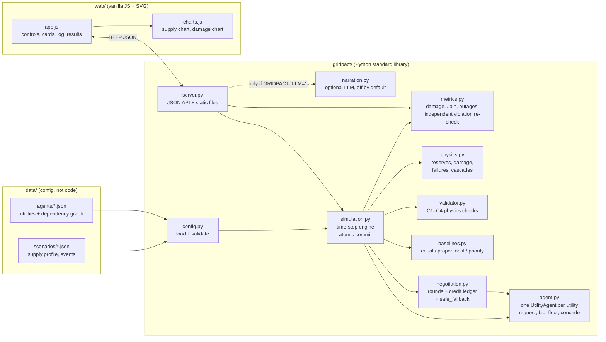
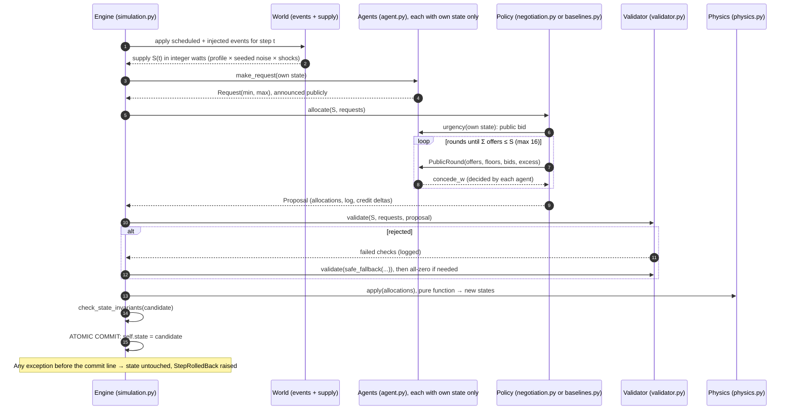

# Architecture

GridPact is a single Python process with no third-party dependencies. It runs the simulator
and serves a static dashboard over `http://127.0.0.1:8041`. The browser never computes an
allocation: it displays step records produced by the engine.

## Components

## Data flow through one time step

## Modules, file by file

| File | What it does, in plain words |
|---|---|
| [gridpact.py](gridpact.py) | The one command. `python3 gridpact.py` opens the dashboard; `test`, `run`, `results` and `check` (a pre-flight report for the demo laptop) are sub-commands. |
| [gridpact/models.py](gridpact/models.py) | Plain frozen records: `AgentConfig`, `AgentState`, `Request`, `Proposal`, `SimState`. Frozen means they can't be changed after creation. That is the basis of the atomic commit. Power on the wire is integer watts. |
| [gridpact/config.py](gridpact/config.py) | Reads `data/scenarios/*.json` and the agents file each scenario names. Rejects bad input loudly (min > desired, unknown agent in an event, dependency cycles onto itself, and so on). |
| [gridpact/agent.py](gridpact/agent.py) | `UtilityAgent`: one per utility. Builds its request, computes its urgency bid, chooses its floor (hold firm or dig into reserves), and decides how much to concede each round. Every method receives only the agent's **own** state plus a `PublicRound`. |
| [gridpact/negotiation.py](gridpact/negotiation.py) | The GridPact protocol: uncontested grant, phase 1 and phase 2 rounds, the relative fairness-credit ledger, and the deterministic `safe_fallback`. It moves public numbers only; it never decides anyone's concession. |
| [gridpact/baselines.py](gridpact/baselines.py) | Three centralized comparison rules: equal split (water-filling), proportional to demand, strict priority. Same inputs, same validator, same physics. |
| [gridpact/validator.py](gridpact/validator.py) | The neutral referee: checks C1 to C4 and logs every check. It knows nothing about urgency or damage, so it can't pick winners. |
| [gridpact/physics.py](gridpact/physics.py) | What power does once allocated: loads first, recharge with surplus, reserve discharge per the agent's policy, cascades over the dependency graph (iterated to a fixed point), escalating damage. A pure function. |
| [gridpact/simulation.py](gridpact/simulation.py) | The step engine. Applies events, computes seeded supply, calls the policy, validator and physics, checks invariants, commits atomically, writes a step record. Records injected events so runs can be replayed exactly. |
| [gridpact/metrics.py](gridpact/metrics.py) | Total damage, failure events, longest outage, Jain's index, critical kWh unserved, rounds, fallback steps, timing. Re-checks capacity from raw watts, without trusting the validator. `compare()` runs all four policies on identical inputs. |
| [gridpact/live.py](gridpact/live.py) | A live dashboard run: GridPact plus the three baselines stepping in lockstep, with every injected event applied to all four at the same step. Feeds the "Same storm, every policy" panel. A test checks its totals equal a full replay. |
| [gridpact/server.py](gridpact/server.py) | Standard-library `ThreadingHTTPServer`. Serves `web/` and a small JSON API (session, step, inject, compare, narrate). A lock serializes simulation mutations. |
| [gridpact/city.py](gridpact/city.py) | Real-city mode. Turns [data/cities/mumbai.json](data/cities/mumbai.json) (every number tagged measured / derived / assumption, with its source) into an ordinary `Scenario`: sector loads from published inputs, each disaster's recorded loss subtracted from that day's demand curve, harm in household-hours. Runs all four policies plus a 24-version ensemble forecast. Allocates nothing itself. See [CITY.md](CITY.md). |
| [gridpact/narration.py](gridpact/narration.py) | Optional plain-English narration of a finished step via an LLM API. Off unless `GRIDPACT_LLM=1`; the SDK is imported lazily; failures return a message; the output never feeds back into allocation. |
| [web/index.html](web/index.html), [web/styles.css](web/styles.css) | Dashboard shell and design tokens (dark control-room palette, self-hosted IBM Plex fonts in `web/fonts/`). |
| [web/app.js](web/app.js) | Controls (scenario, seed, play / pause / step, speed), agent cards, negotiation log, event injection, results view. Re-checks capacity in the browser too. |
| [web/city.html](web/city.html), [web/city.js](web/city.js), [web/city.css](web/city.css) | The Mumbai page: ward map (24 BMC wards, shaded by households with power, time scrubber), recorded timeline, supply vs demand, per-sector small multiples for all four policies, forecast table, derivations and sources. |
| [web/charts.js](web/charts.js) | Hand-drawn SVG: stacked allocations, supply line, demand line, the hatched deficit wedge, event markers, hover tooltips; cumulative-damage chart for the results view. |
| [data/agents/city_core.json](data/agents/city_core.json) | The four core utilities and their dependency graph (Telecom → Emergency, Water → Hospital, Telecom → Hospital). |
| [data/agents/metro_24.json](data/agents/metro_24.json) | 24 utilities for the stress test, generated by [scripts/gen_stress_agents.py](scripts/gen_stress_agents.py) (fixed seed). |
| [data/cities/](data/cities/) | `mumbai.json` (sourced inputs, disasters, sources) and `mumbai_map.json` (ward shapes, built by [scripts/build_city_map.py](scripts/build_city_map.py)). |
| [data/scenarios/](data/scenarios/) | Cyclone landfall, cascading substation failures, long heatwave brownout, metro stress test. |
| [scripts/generate_results.py](scripts/generate_results.py) | Writes RESULTS.md from real runs (10 seeds, honesty experiment, scaling). |
| [scripts/worked_example.py](scripts/worked_example.py) | Writes the round-by-round worked example into ALGORITHM.md from a real step. |
| [tests/](tests/) | 69 `unittest` tests (15 of them on the Mumbai data in `test_city.py`). The three hard guarantees live in `test_invariants.py`, `test_atomicity.py` and `test_determinism.py`. |

## HTTP API

| Method and path | Body | Returns |
|---|---|---|
| `GET /api/scenarios` | | list of scenarios, whether narration is on |
| `POST /api/session` | `{scenario, seed}` | new GridPact run + public scenario info |
| `POST /api/step` | `{session, n}` | the next n step records + live standings for all four policies |
| `POST /api/inject` | `{session, event_id}` | queues an injectable event for the next step |
| `POST /api/compare` | `{session}` | all four policies on the same seed and event log, plus metrics |
| `POST /api/narrate` | `{session, step}` | optional LLM narration |
| `GET /api/city` | | Mumbai: sourced data, derivation table, disasters, ward map |
| `POST /api/city/run` | `{disaster, intensity, seed}` | all four policies + ensemble forecast (cached; runs are deterministic) |

## Where each guarantee is enforced

| Guarantee | Enforced in | Proven by |
|---|---|---|
| Zero capacity violations | `validator.py` C3 and C4 on integer watts; fallback → all-zero chain in `simulation.py` | `tests/test_invariants.py`: every scenario × policy × 4 seeds, random live injections, a supply collapse to ~0, a deliberately broken policy, 3,000-case fallback fuzz; metrics re-check independently |
| No inconsistent state | frozen dataclasses + single-assignment commit in `Simulation.step` | `tests/test_atomicity.py`: crash at 6 stages, state object identical; crash-then-continue equals a clean run |
| Determinism | per-step `random.Random(seed × 1,000,003 + step)`; injected events logged with their step | `tests/test_determinism.py`: same seed → byte-identical records (timing excluded), live injection replays exactly |
