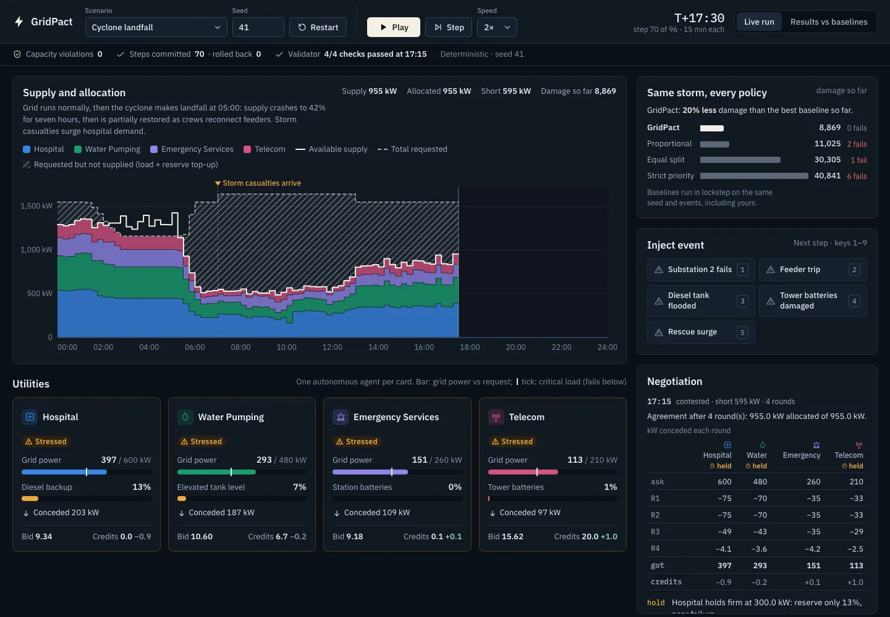
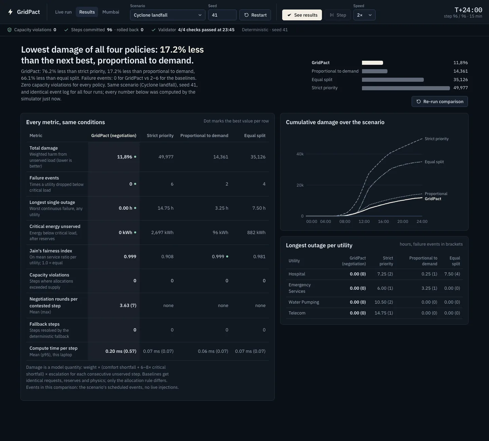
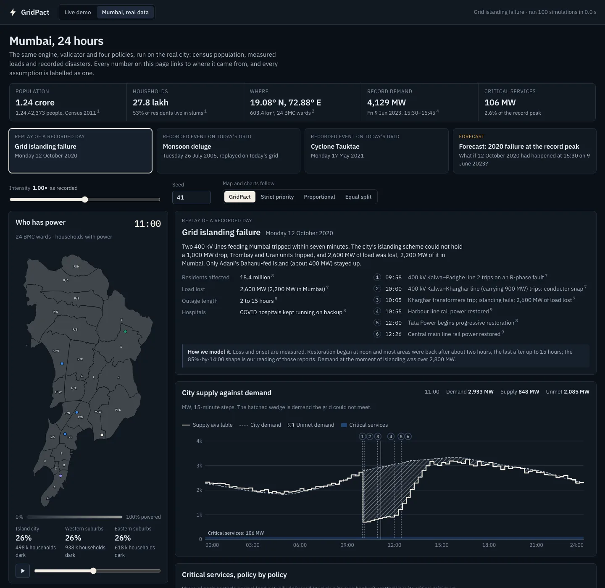
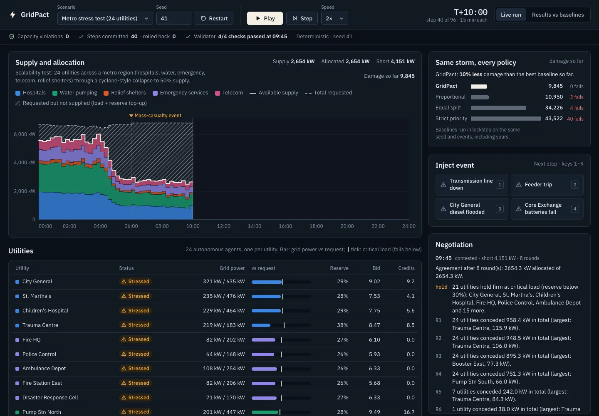

# GridPact

**Autonomous utility agents that negotiate scarce power during a disaster.**
Team Straw Hats (Team 41) · Build Beyond '26, BMSCE · Problem statement PS 1.1.

During a cyclone, heatwave or substation cascade, a city's hospitals, water pumps, emergency
services and telecom usually compete blindly for whatever power is left, and failures cascade.
In GridPact each utility is an **autonomous agent** with private state: backup reserves, an
escalating damage curve, and fairness credits. Every 15 simulated minutes the agents **bid,
concede and agree** on a split of the fluctuating supply. A **neutral validator** only enforces
physics (never more than the supply, never more than requested) and commits each step
**atomically**. It never decides who gets what.



## Results (from real runs, 10 seeds per scenario)

| Scenario | GridPact damage vs strict priority | vs proportional | vs equal split | GridPact failure events | Capacity violations |
|---|---:|---:|---:|---:|---:|
| Cyclone landfall | −75.6% | −14.8% | −65.9% | 0 | 0 |
| Cascading substation failures | −72.9% | −2.3% | −63.5% | 0 | 0 |
| Long heatwave brownout (36 h) | −69.9% | −7.4% | −74.2% | 0 | 0 |
| Metro stress test (24 utilities) | −72.7% | −5.2% | −72.8% | 0 | 0 |

GridPact had the lowest damage in 10/10 seeds in every scenario. Full tables, a lying-agent
experiment, scaling to 192 agents and honest limitations: **[RESULTS.md](RESULTS.md)**
(generated by a script; never hand-edited).



## Run it: one command, fully offline

Requires Python 3.9 or newer. **Nothing to install**: standard library only, fonts bundled, no CDN.

```bash
python3 gridpact.py            # opens the dashboard at http://127.0.0.1:8041
```

Other commands:

```bash
python3 gridpact.py check                               # pre-flight on the demo laptop: tests, scenarios, port, narration
python3 gridpact.py test                                # all 69 tests (the hard guarantees + real-city checks)
python3 gridpact.py run cyclone_landfall --seed 41      # headless: every policy, every metric
python3 gridpact.py results                             # regenerate RESULTS.md and CITY.md (~12 s)
python3 scripts/worked_example.py                       # regenerate the worked example in ALGORITHM.md
python3 gridpact.py serve --port 9000 --no-browser      # different port, don't auto-open a browser
```

### Scenarios

Pick one in the dashboard's **Scenario** menu, or headless with `python3 gridpact.py run <id>`:

| id | What happens |
|---|---|
| `cyclone_landfall` | Normal grid, then landfall at 05:00: supply crashes to 42% for 7 h, partial restore; hospital casualty surge. |
| `cascading_substations` | Three substations trip one after another (02:15, 06:15, 11:15), stepping down to 48%. |
| `heatwave_brownout` | 36 h of prolonged scarcity (52–68%) with cooling-load surges. Fairness over time matters most here. |
| `stress_metro_24` | Scalability: 24 utilities (hospitals, water, emergency, telecom, shelters) through a 50% collapse. |

Scenarios and agents are JSON in [`data/`](data/). Add a utility or a disaster by editing a file.

### Mumbai, on real data

Open **Mumbai, real data** from the dashboard header (`http://127.0.0.1:8041/city.html`). The
same engine runs on Census 2011 population for all 24 BMC wards, published loads for hospitals,
water pumping, the mobile network and fire/police stations, and four recorded or forecast
disasters: the 12 Oct 2020 grid failure, the 26 Jul 2005 deluge, Cyclone Tauktae (2021), and the
2020 failure striking at the 2023 record peak. Each run is a 24-version ensemble forecast with
10th–90th percentile ranges. Every number links to its source, and every assumption is labelled.
What we learned, including the three bugs real data exposed and why GridPact ties rather than
beats the best baseline there: **[CITY.md](CITY.md)**.





### Using the dashboard

- **Play / Pause** (Space), **Step** (→), **Speed**, **Seed**, **Restart**.
- **Same storm, every policy**: the three baselines run in lockstep with the live run (same seed, same events, including yours), so the damage comparison updates as you watch.
- **Inject event** (keys **1–9**): for example "Substation 2 fails: −30% supply for 2 h". It lands on the next step, and the log shows how the agents responded.
- **Negotiation ledger**: the latest step's rounds as a table: what each agent asked for, conceded per round, got, and its credit change.
- **Negotiation log**: the outcome first, then who held firm, then each round's concessions and the fairness-credit changes.
- **Guarantees strip** (always visible): capacity violations, steps committed or rolled back, validator checks.
- **Results vs baselines**: re-runs all four policies on the same seed *and the same injected events*.

### Optional LLM narration (off by default)

```bash
pip install anthropic
export ANTHROPIC_API_KEY=...          # your key, set in your own terminal
export GRIDPACT_LLM_MODEL=...          # a model id available on your account
GRIDPACT_LLM=1 python3 gridpact.py
```

Check it with `GRIDPACT_LLM=1 python3 gridpact.py check` (it makes one real call). A "Narrate
step" button then appears in the Negotiation panel and asks the LLM to explain the step's log in
plain English. The
simulator never depends on it: the SDK is imported only when enabled, failures show a message,
and the narration never influences allocation.

## Hard guarantees, enforced and tested

| Guarantee | How | Test |
|---|---|---|
| Zero capacity violations | integer watts; validator C1–C4; safe fallback; independent re-check in metrics | [tests/test_invariants.py](tests/test_invariants.py) |
| No inconsistent state | frozen state objects; one-line atomic commit; rollback on any error | [tests/test_atomicity.py](tests/test_atomicity.py) |
| Deterministic given a seed | per-step seeded noise; injected events logged and replayed | [tests/test_determinism.py](tests/test_determinism.py) |

## Documentation

| Doc | What's in it |
|---|---|
| [ARCHITECTURE.md](ARCHITECTURE.md) | Component and one-time-step diagrams (Mermaid); every file explained |
| [ALGORITHM.md](ALGORITHM.md) | The exact math, plus a round-by-round worked example from a real step |
| [DECISIONS.md](DECISIONS.md) | Every tech and algorithm choice: alternatives and why |
| [JUDGE_QA.md](JUDGE_QA.md) | The 15 toughest questions, answered from the code |
| [RESULTS.md](RESULTS.md) | Generated metric tables, experiments, limitations |
| [DEMO_SCRIPT.md](DEMO_SCRIPT.md) | The 1-minute demo, click by click |

## Project layout

```
gridpact.py              one-command entry point
gridpact/                engine (standard library only)
  agent.py               one autonomous agent per utility
  negotiation.py         rounds, fairness ledger, deterministic fallback
  validator.py           physics-only checks C1–C4
  physics.py             reserves, damage, failures, cascades
  simulation.py          time-step engine, atomic commit
  baselines.py           equal / proportional / strict priority
  metrics.py             all metrics + policy comparison
  config.py, models.py   data loading and frozen records
  live.py                live run + baselines in lockstep
  city.py                Mumbai: sourced data -> scenario, ensemble forecast
  server.py              offline HTTP server + JSON API
  narration.py           optional LLM narration
web/                     dashboard + Mumbai page (vanilla JS, SVG charts, bundled fonts)
data/                    agents, scenarios, and cities/mumbai*.json (JSON)
scripts/                 results generator, worked example, stress-agent generator
tests/                   69 unittest tests
```

Design context for the UI lives in [PRODUCT.md](PRODUCT.md) (Impeccable design skill).
